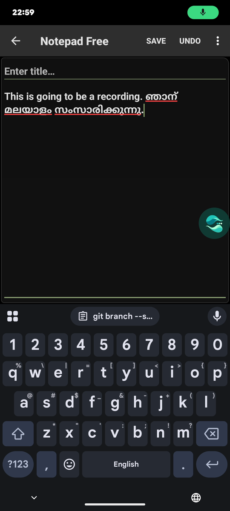
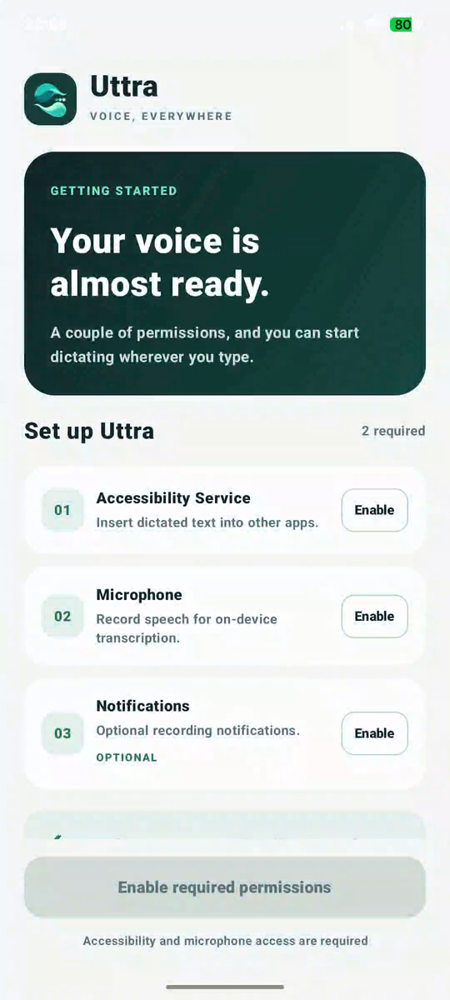
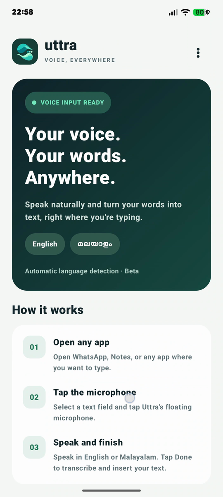
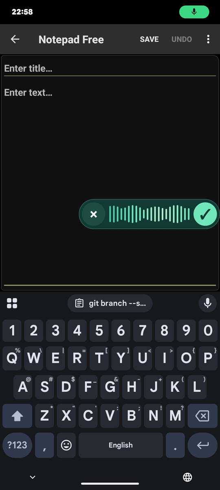
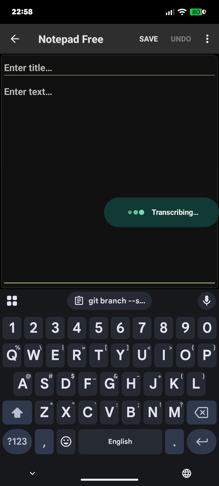
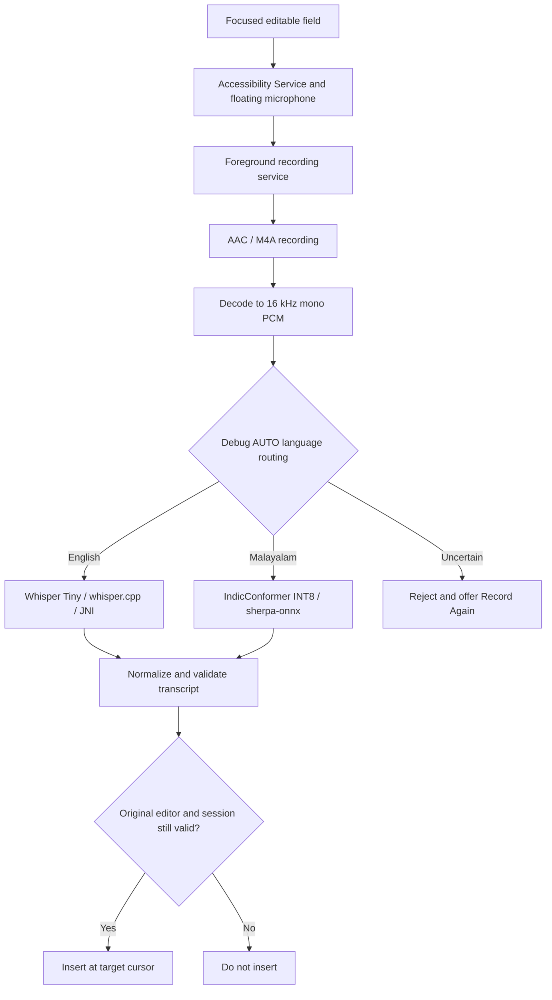
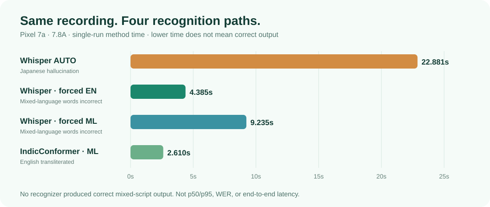

<div align="center">
  

  # Uttra (ഉത്ര)

  **Your voice. Your words. Anywhere.**

  *Fully offline, native Android cross-app dictation — an independent English/Malayalam engineering prototype.*

  
  
  
  
  

  <sub>Built and tested primarily on a Pixel 7a · Engineering evidence snapshot: 19 October 2026</sub>
</div>

---

Uttra explores a focused question: **Can native Android dictation work across other applications without sending audio to a speech-recognition server?** It combines local speech models with an Accessibility-driven microphone overlay, editor/session validation, and recoverable error handling. This is an **independent prototype**, not a production-ready release or a claim of parity with commercial dictation products.

**Jump to:** [Capabilities](#-current-capabilities) · [Requirements](#-requirements) · [Engineering decisions](#-engineering-decisions--benchmarks) · [Fresh-clone setup](#set-up-from-a-fresh-clone) · [Reproducibility](#reproducibility-status)

## ✨ Current capabilities

| Experience | Current implementation |
|---|---|
| **Cross-app dictation** | Floating microphone for eligible focused text fields; local recognition followed by guarded insertion into the original editor |
| **English speech** | Multilingual **Whisper Tiny** through `whisper.cpp`, C++ and JNI |
| **Malayalam speech** | **IndicConformer INT8 ONNX** through `sherpa-onnx` 1.13.8 |
| **Offline operation** | No speech-transcription server is used after model provisioning |
| **Interaction** | Compose onboarding, branded microphone bubble, waveform recording state, Done/Cancel, processing indicator and Record Again |
| **Reliability** | Editor/focus/session checks, cursor-aware insertion, blank-output filtering and refusal to insert when the target has changed |
| **Language handling** | Experimental whole-recording English/Malayalam AUTO router in **debug builds**, with score-based rejection |

> **Beta status:** English and Malayalam have been demonstrated in **separate recordings**. Automatic switching *within the same recording* is **not reliably supported**. The language chips on the home screen indicate supported languages; they are **not selectors**. The current non-debug recording path defaults to Malayalam and is not yet equivalent to the debug AUTO experience.


## 📱 Uttra in action
### 🎬 Watch the offline demo

[](YOUR_VIDEO_URL)

▶ **[Watch the 62-second offline demo](https://drive.google.com/file/d/1YYXVFZLFTLZ1IvxuGwhyO-xscmfLVdzm/view?usp=sharing)**

Real Pixel 7a screen captures from a single development walkthrough. The English and Malayalam examples were dictated in **two separate recordings**, not automatically switched within one utterance.
### Screenshots


<p align="center">
  
  
  
  
  
</p>

<p align="center"><sub>Permission setup · Home · Recording · Transcribing · Cross-app text insertion</sub></p>


## ⚡ Engineering at a Glance

Uttra is an independent native Android experiment exploring
fully offline, cross-application voice dictation.

- **Android platform:** Kotlin, Jetpack Compose,
  Accessibility Services, foreground microphone recording,
  editor/session validation, and cursor-safe text insertion.

- **On-device ASR:** Whisper Tiny through C++/JNI for English;
  IndicConformer INT8 through sherpa-onnx for Malayalam.

- **Reliability engineering:** RMS/peak analysis, experimental
  language detection, transcription validation, stale-editor
  protection, and recoverable failure handling.

- **Measured experiments:** Six selected single-language
  recordings successfully routed and inserted. Additional
  benchmarks document latency, ambiguous language detection,
  and mixed-language recognition failures.

**Current status:** English and Malayalam work in demonstrated
separate recordings. Automatic code-switching remains research.


## 🧰 Requirements

- macOS (the setup scripts have been tested on macOS; other operating systems are not yet verified)
- Android Studio
- Android SDK, NDK, and CMake versions required by the Gradle project
- A JDK compatible with the project's Android Gradle Plugin
- Git, `curl`, `shasum`, and Android Debug Bridge (`adb`)
- Internet access for the initial dependency and model downloads; speech inference runs locally afterward
- An Android device with USB debugging enabled; testing so far is centered on **Pixel 7a**

## 🔬 Engineering decisions & benchmarks

> **Reading the evidence:** **Observed** numbers come from individual runs or saved logs. **Manual validation** means a small developer-selected sample. **Exploratory** results are research, not shipped Android features. **Pending** means no verified benchmark exists yet. Times below are primarily recognition-method elapsed measurements—not model-only kernel times, p50/p95 figures, or microphone-stop-to-text-insertion latency.

### 1. End-to-end architecture



The pipeline is implemented around `MicrophoneRecordingService.kt`, `UttraSpeechTranscriber.kt`, `LanguageDetection.kt`, `WhisperNativeTranscriber.kt`, `IndicMalayalamTranscriber.kt`, `UttraAccessibilityService.kt` and `UttraOverlayController.kt`. A language can also be forced internally for controlled experiments; the UI does not yet offer a production language picker.

The central Android engineering challenge is **not just converting speech to text**: the asynchronous result must still belong to the same editor, focus/window, cursor state and recording session. Unusable transcriptions or stale targets must not silently replace text in a different app.

### 2. Why measure RMS and peak amplitude?

Whisper can produce a language prediction even on background noise or apparent silence. Before experimental language identification, Uttra calculates two inexpensive statistics over decoded floating-point PCM samples `xᵢ`:

- **Root-mean-square (RMS)** — average signal amplitude/energy proxy: `sqrt(Σ(xᵢ²) / N)`
- **Peak** — largest instantaneous absolute sample: `max(|xᵢ|)`

Current heuristic:

```kotlin
val nearSilence = rms < 0.003 && peak < 0.015f
if (nearSilence) {
    // Reject instead of invoking a recognizer on very low-level audio.
}
```

Both conditions must be met. RMS and peak serve different purposes: a short transient can have a high peak but low overall energy, while sustained noise can have measurable RMS without speech. **Neither statistic establishes that speech exists or identifies its language.** These thresholds are experimental and may reject quiet genuine speech or admit noise.

**Why a second filter?** Recognition can still return non-lexical results such as `[BLANK_AUDIO]`. Transcript formatting, blank-output checks and the **Record Again** recovery state provide another protection against unwanted editor insertion. Two observed silent trials inserted no text, even though Whisper's language-ID stage guessed English.

### 3. Why use confidence ratios instead of the highest language score?

`WhisperLanguageDetector` reads English (`en`) and Malayalam (`ml`) language scores through a native Whisper language-detection call. Choosing only the larger score would force a decision on ambiguous recordings, so Uttra applies these **heuristic** rules:

| Rule | Code-level condition | Purpose |
|---|---|---|
| Original strict route | `max(en, ml) >= 0.10` **and** `max(en, ml) >= 5 × min(en, ml)` | Accept a strong, clearly separated winner |
| Later English-only relaxation | `en > ml` **and** `en >= 0.35` **and** `en >= 2 × ml` | Experimentally permit strong English when the 5× condition fails |
| Neither passes | Reject as uncertain | Avoid forcing a potentially incorrect transcription into the editor |

The English relaxation was motivated by an actual 2.276-second English recording (“I will call you tomorrow morning”): **EN 0.4940**, **ML 0.2038**, **RMS 0.0390**. It was rejected under the original 5× rule despite intended English speech. **The exact same recording was not subsequently verified as successful under the changed rule**; later tested English samples already passed the strict condition. The relaxation's improvement has therefore **not** been proven quantitatively.

#### Small manual validation — six single-language recordings

| Language | Length | `en` score | `ml` score | Result |
|---|---:|---:|---:|---|
| English | 3.599 s | 0.71947 | 0.00137 | English accepted |
| English | 5.642 s | 0.63981 | 0.01320 | English accepted |
| English | 10.472 s | 0.54099 | 0.00120 | English accepted |
| Malayalam | 5.805 s | 0.01344 | 0.44395 | Malayalam accepted |
| Malayalam | 9.404 s | 0.00505 | 0.89317 | Malayalam accepted |
| Malayalam | 14.954 s | 0.00042 | 0.98050 | Malayalam accepted |

**Observed:** **3/3 English and 3/3 Malayalam** selected recordings were routed to the intended engine and produced usable inserted text on the Pixel 7a. A subjective assessment of roughly **90–99% text correctness** in selected demonstrations is **not** a measured word-error rate (WER), character-error rate (CER), or statistically meaningful ASR accuracy.

#### Failure cases informed the design

| Test case | Selected measurements | Observed outcome |
|---|---|---|
| Short Malayalam, 1.741 s | EN `0.0191` · ML `0.0119` · RMS `0.0310` | `LOW_SCORE` despite measurable audio |
| Mixed speech, 7.059 s | EN `0.02381` · ML `0.01281` · RMS `0.03474` | `LOW_SCORE` |
| Mixed speech, 3.855 s | EN `0.32052` · ML `0.12367` · RMS `0.03849` | `AMBIGUOUS_SCORES`; relaxed EN rule still fails (`en < 0.35`) |
| “Silent” recording, 5.294 s | EN `0.60890` · RMS `0.01957` · peak `0.28443` | Language guess was English, but no text was inserted |
| “Silent” recording, 6.037 s | EN `0.53201` · RMS `0.01733` · peak `0.18083` | Again no text inserted; Record Again flow |

**Lesson:** language-ID score, acoustic activity and valid transcript content are **different signals**. A whole-recording language label also cannot locate a switch from English to Malayalam midway through speech.

### 4. Why Whisper Tiny and IndicConformer? What about the alternatives?

| Candidate | Evaluation / role | Status |
|---|---|---|
| **Whisper Tiny multilingual** | Current local English ASR plus language-ID probabilities through `whisper.cpp` / JNI | **Active prototype baseline**; practical smaller candidate, not proven optimal |
| **Whisper Base multilingual** | Downloadable and available as a larger comparison candidate | **Not the active model**; no controlled same-audio Tiny-vs-Base mobile benchmark completed |
| **IndicConformer INT8 ONNX** | Local Malayalam recognition through `sherpa-onnx` | **Active Malayalam path**; preserves Malayalam wording in selected tests, but may transliterate English into Malayalam script |
| **SpeechBrain VoxLingua107** | Dedicated **language identification**, not ASR; Mac/PyTorch → ONNX exploration | **Deferred**; classifier-head parity seen, feature-extractor export/integration unfinished |
| **Whisper beam search, larger models, other ASR families** | Possible accuracy/latency/memory comparisons | **Not yet established** with an apples-to-apples Pixel benchmark |
| **VAD / language-aware segmentation** | Possible speech/silence gating and switch-boundary discovery | **Research**, not an integrated trained detector |

**Why Tiny?** It was a workable, relatively compact starting point for on-device C++/JNI integration. Larger models can entail different memory, distribution and compute costs, but there is **no measured proof that Tiny offers the best trade-off** here. In the current native wrapper, Whisper uses **greedy sampling**, **two threads**, `translate=false`, and `no_context=true`. A fair Tiny-vs-Base decision would require identical source clips, settings, accuracy reference text, model-load and memory measurements, and repeated on-device timing.

**Why two ASR engines?** They fail differently on mixed speech: forced-English Whisper can reproduce an English opening but substitute incorrect English for Malayalam; IndicConformer can recover Malayalam while transliterating the English opening into Malayalam script. The specialized routes are useful for **separate-language** recordings, not a solved code-switcher.

### 5. Alternative language detection: VoxLingua107 / SpeechBrain ONNX

A dedicated SpeechBrain/VoxLingua107 classifier was explored on Mac to test whether language ID could be separated from Whisper recognition. **Five classifier-head ONNX/PyTorch comparisons**, using the **same precomputed acoustic features**, returned matching top classes:

| Fixture | Feature frames | Maximum absolute output difference | Top class |
|---|---:|---:|---|
| `malayalam_03` | 149 | `0.00002098` | Match |
| `english_03` | 226 | `0.00002217` | Match |
| `live_auto_rejected_04` | 400 | `0.00002289` | Match |
| `malayalam_02` | 918 | `0.00001717` | Match |
| `quiet_malayalam_01` | 307 | `0.00001717` | Match |

All observed maximum absolute differences were below **2.3 × 10⁻⁵**. This verifies *classifier-head numerical parity given the same prepared features*, **not** correct English/Malayalam ground-truth predictions or Android end-to-end parity. Exporting the feature extractor hit an ONNX complex-STFT limitation. Possible native ONNX Runtime packaging interactions with `sherpa-onnx` were also not resolved. **VoxLingua107 was not integrated into Uttra's Android runtime.**

### 6. Mixed-language benchmark 7.8A — four full-audio recognition paths

**Reference:** `This is going to be a mixed recording, ഞാൻ അങ്ങനെ നോക്കാം`

A single **87,952-byte AAC/M4A mixed recording** was passed through four configurations. Each row is **one observed run**, not a median or fair performance ranking between recognizers.

| Whole-audio path | Time | Actual output / observation |
|---|---:|---|
| Whisper automatic-language transcription | **22,881 ms** | Incorrect repeated Japanese text beginning `このように、アクセルのように…` |
| Whisper forced English | **4,385 ms** | `This is going to be a mixed recording in an angle in a knockout.` |
| Whisper forced Malayalam | **9,235 ms** | `This is going to be a mixed recording in an angle in a knockout.` |
| IndicConformer Malayalam | **2,610 ms** | `തീസ് ഈസ് ഗോയിങ് ടു ബീ അ മിക്സഡ് റെക്കോഡിംങ്് ഞാന് അങ്ങനെ നോക്കാം` |

The forced-English path handled the English opening but treated Malayalam as English; IndicConformer mostly recovered the Malayalam ending while transliterating English into Malayalam characters. Whisper AUTO produced an unrelated hallucination in this one test. **No recognizer produced the intended mixed-script sentence end to end.**


<p align="center">
  
</p>


### 7. Mixed-language benchmark 7.8B — three manual segmentation attempts

On a **different ~6-second recording**, English and Malayalam boundaries were selected manually with FFmpeg, then each segment was replayed through the appropriate on-device engine. These cuts were **not** made automatically by Uttra.

| Manual cut | English / Whisper output (time) | Malayalam / IndicConformer output (time) | Lesson |
|---|---|---|---|
| Malayalam starts late (~3.85 s) | `This is going to be mixed according to an unknown.` (**4,511 ms**) | `അ അങ്ങ` (**1,574 ms**) | Late boundary clips Malayalam |
| English 0–2.55 s; Malayalam from 2.56 s | `This is going to be mixed up.` (**2,696 ms**) | `ഞാൻ അങ്ങനെ നോക്കാം` (**2,085 ms**) | Malayalam recovers; English word crosses boundary |
| English 0–3.15 s; Malayalam from 3.05 s (overlap) | `This is going to be mixed according.` (**2,633 ms**) | `ഞാന് അങ്ങനെ നോക്കാം` (**1,879 ms**) | Both audible clips complete, but English ASR error persists |

The better Malayalam result is encouraging, but this is **not** a correct bilingual transcription: the English segment loses the article “a” and confuses **“recording”** with **“according.”** Malayalam `ഞാന്` versus `ഞാൻ` also illustrates a possible orthographic-normalization problem.

### 8. Mixed-language benchmark 7.8C — same-fixture whole vs segmented

The saved diagnostic report for the **second** recording lists full audio **97,980 bytes**, English segment **40,171 bytes**, and Malayalam segment **36,706 bytes**:

| Path | Observed time | Actual transcription |
|---|---:|---|
| Whisper English on the whole second recording | **3,146 ms** | `This is going to be mixed according to Nyan Anomenoka.` |
| Whisper English on English segment | **2,568 ms** | `This is going to be mixed according.` |
| IndicConformer on Malayalam segment | **1,931 ms** | `ഞാന് അങ്ങനെ നോക്കാം` |

This follow-up isolates **the same second recording**, unlike 7.8A. Correctly isolating Malayalam helps recognition of that part; it does **not** fix the English substitution or create an automatic segmenter/merger. The English and Malayalam clips have different durations. **Do not compare 7.8A and 7.8B/C as a same-audio regression.**

### 9. Performance limits and engineering conclusions

| What the evidence supports | What it does **not** establish |
|---|---|
| Local end-to-end insertion on selected English and Malayalam recordings | Production-grade multilingual ASR accuracy or broad app compatibility |
| Language probability scores, RMS/peak and individual recognition elapsed times | Calibrated VAD, WER/CER, p50/p95, end-to-end perceived latency |
| Complementary mixed-audio recognition errors and manually recoverable Malayalam | Automatic code-switch boundary detection, alignment or reliable merged transcription |
| ONNX/PyTorch classifier-head parity for five prepared feature sets | A deployable VoxLingua107 classifier with proven Android feature preprocessing |
| Current Whisper Tiny is a functioning Android baseline | Measured superiority to Base, Large, beam search or unrelated ASR models |

**Next controlled experiments:** compare Tiny vs Base and greedy vs beam search on the *same saved English recordings*; evaluate WER/CER, cold/warm load, repeated recognition timing, peak memory and power; explore robust VAD and language-aware segmentation; validate editor behavior across more devices and apps. None of these experiments should be presented as already completed.

**Research workflow note:** the mixed-language benchmarks live on the separate `feature/mixed-language` branch. Debug audio fixture capture and report writing there are experiment instrumentation, **not** shipping capabilities in the stable branch. `connectedDebugAndroidTest` previously removed the app and app-private models during testing, so subsequent research switched to saved fixtures and debug in-app triggers rather than treating an instrumentation test pass as proof of feature correctness.

---

## Set up from a fresh clone

### 1. Clone the repository

```bash
git clone --recurse-submodules https://github.com/paulmathew/Uttra.git
cd Uttra
```

If you cloned without submodules, run:

```bash
git submodule update --init --recursive
```

### 2. Download the sherpa-onnx dependency

```bash
bash scripts/setup-sherpa-onnx.sh
```

Downloads and checks the SHA-256 checksum of `sherpa-onnx-1.13.8.aar` in `app/libs/`.

### 3. Download Whisper models

```bash
bash scripts/setup-whisper-models.sh
```

Downloads and verifies Whisper Tiny and Base model files in:

```text
app/src/main/assets/models/
```

These binaries are excluded from Git.

### 4. Download the Malayalam IndicConformer model

```bash
bash scripts/setup-indic-malayalam.sh
```

Downloads and verifies `model.int8.onnx` and `tokens.txt` in:

```text
.local-models/indic_ml/
```

This directory is excluded from Git.

### 5. Build Uttra

Use Android Studio to install any SDK, NDK, or CMake components required by the Gradle project. Then run:

```bash
./gradlew :app:assembleDebug
```

### 6. Install the debug application

Connect and authorize your Android device, then run:

```bash
adb devices -l
./gradlew :app:installDebug
```

### 7. Provision the Malayalam model onto the device

```bash
bash scripts/install-indic-malayalam-android.sh
```

The script checks the model files and installs any missing verified files into Uttra's application-private `files/indic_ml/` directory. Existing matching files are kept; existing files with unexpected checksums cause the script to stop rather than overwrite them.

This mechanism requires an **installed, debuggable Uttra build** and uses `adb run-as`. It is for development setup, not production distribution. If more than one Android device is connected, set `ANDROID_SERIAL` to choose a device.

### 8. Enable Uttra and test dictation

Launch Uttra, grant microphone permission, and enable the Uttra Accessibility Service in Android Settings. Focus an editable text field in another app, use the floating microphone to record speech, and confirm to transcribe and insert the result.

Do not test message insertion by automatically sending messages; confirm the text appears in the intended editable field first.

## Development notes

- Stable development branch: `main`; create feature branches for new work.
- Speech recognition runs locally on the device after provisioning.
- Large speech models and the sherpa-onnx AAR are not stored in Git.
- Native accessibility `InputConnection` insertion is available on Android 13+ and was tested on a Pixel 7a. Older Android versions require separate compatibility validation.
- The current model-provisioning script supports **debug builds**; production distribution requires a separate model-installation strategy.
- Model downloads are pinned using SHA-256 checksums.

## Reproducibility status

**Verified on the development machine:**

- sherpa-onnx AAR download and SHA-256 verification
- Whisper model download and SHA-256 verification
- IndicConformer Malayalam model download and SHA-256 verification
- Android debug build
- Existing-device model verification (no-op when files match)
- Test-file provisioning through ADB into app-private storage

**Not yet verified:**

- End-to-end setup on a separate fresh laptop
- Full Malayalam model provisioning into a fresh app installation
- Production model delivery and installation
